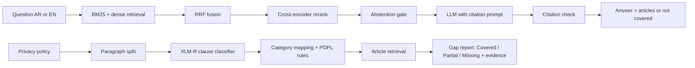

# PDPL Compliance Copilot

AI-powered assistant for the Saudi Personal Data Protection Law (PDPL): ask the law in Arabic or English and always see the supporting article, and check a privacy policy for gaps against a PDPL requirements checklist.

> **Not legal advice.** Outputs are first-pass aids. A requirement marked *Covered* does not mean the organisation is compliant.

**Track:** B (LegalTech, NLP and RAG), Olo Academy AIEP capstone
**Team:** ⟨Member 1 name⟩ · ⟨Member 2 name⟩ · ⟨Member 3 name⟩

---

## 1. Problem and users

Most startups in the Kingdom have no in-house legal team. A general chatbot invents article numbers and mixes Saudi law with GDPR. This project answers **only from the official texts**, cites the exact article, says *"not covered"* when the texts do not answer, and reviews a privacy policy against the PDPL.

| User | Need |
|---|---|
| Compliance / legal officer | Quick cited answers and a first-pass policy review |
| Product manager / engineer | Practical questions, e.g. "can we store user data outside the Kingdom?" |
| Auditor | The evidence behind every statement |

## 2. What it does

1. **Structured legal knowledge base**: PDPL, Implementing Regulation and Transfer Regulation (Arabic + English), parsed into article-level chunks with metadata.
2. **Grounded bilingual Q&A**: BM25 + dense retrieval, fusion, cross-encoder reranking, LLM answer with article citations, programmatic citation check, and abstention.
3. **Clause classifier**: XLM-R fine-tuned on OPP-115 (multi-label, per-class thresholds, split by policy).
4. **Gap analyser**: splits a policy into paragraphs, classifies them, applies a PDPL rule layer, and reports **Covered / Partial / Missing** for each of the 15 checklist requirements, with the evidence paragraph and the retrieved article.

## 3. Architecture



⟨Add a screenshot of the app: `docs/images/app_qa.png`, `docs/images/app_gap.png`⟩

## 4. Quick start

**Requirements:** Python ⟨3.x⟩, ⟨GPU optional⟩, ⟨disk space for models and indexes⟩.

```bash
git clone https://github.com/judysuper/PDPL-Compliance-Copilot.git
cd PDPL-Compliance-Copilot
python -m venv .venv
# Windows PowerShell:  .venv\Scripts\Activate.ps1      Linux/macOS: source .venv/bin/activate
pip install -r requirements.txt
```

**Configuration.** Copy `.env.example` to `.env` and fill it. **Never commit keys.**

| Variable | Purpose | Default |
|---|---|---|
| `LLM_PROVIDER` | `gemini`, `ollama` or `mock` (no model needed, for testing the UI) | `ollama` |
| `GEMINI_API_KEY` | Gemini key (provider `gemini`) | none |
| `GEMINI_MODEL` | Primary Gemini model | see `src/generation/generation.py` |
| `OLLAMA_MODEL` | Local model for provider `ollama` | `command-r7b-arabic` |
| `OLLAMA_URL` | Ollama server | `http://localhost:11434/api/generate` |

For `ollama`: install [Ollama](https://ollama.com), run `ollama pull command-r7b-arabic`, keep it running.

**Data and indexes.** ⟨Exact commands to download the corpus and build the indexes, e.g. `python scripts/build_indexes.py`⟩

**Run the demo:**

```bash
streamlit run app/streamlit_app.py
```

First start loads the models and retrieves the 15 checklist questions (cached afterwards in `cache/checklist_retrieval.json`). Delete that file if the corpus or index changes.

**Run the tests:**

```bash
python -m pytest tests -q
```

## 5. Data

| Source | What | Use | Licence / access |
|---|---|---|---|
| PDPL, Implementing Regulation, Transfer Regulation | Official Arabic text + English translation (SDAIA / Bureau of Experts) | Knowledge base | ⟨public official texts: link⟩ |
| OPP-115 | 115 website policies, paragraph-level annotations | Clause classifier | ⟨source link + licence⟩ |
| Gold Q&A set | ⟨N⟩ questions (⟨N⟩ Arabic, ⟨N⟩ unanswerable) with gold articles | Retrieval, answers, abstention | Team-built, `data/...` |
| Local policies | 10 public policies of apps/sites in Saudi Arabia, annotated against the checklist (150 Gold decisions) | Gap analyser evaluation | Team-annotated; sources and access dates in `data/local_policies/` |

Full data card: ⟨`docs/data_card.md`⟩. Splits: OPP-115 is split **by policy**, never by paragraph.

## 6. Gap analyser

- **Checklist:** 15 PDPL requirements, each with article, source document and a verification question (`data/pdpl_checklist/`).
- **Explicit category mapping:** OPP-115 category to requirement, with its gaps discussed (OPP-115 is mostly US websites; some PDPL requirements have no OPP category). See ⟨`docs/category_mapping.md`⟩.
- **Statuses:** `Covered`, `Partial`, `Missing` only.
- **Run on all policies and evaluate:**

```bash
python src/gap_analyzer/run_all_policies_v2.py
python src/gap_analyzer/evaluate_all_policies_v2.py
python src/gap_analyzer/gap_analyzer_v3_gold_cv.py
```

## 7. Results

Reproduce with: ⟨commands or notebooks per experiment⟩. Fill the tables with measured values only.

| Experiment | Question | Result |
|---|---|---|
| E1 | LLM-only vs naive RAG vs hybrid + rerank | ⟨…⟩ |
| E2 | Fixed-size vs article-level chunking | ⟨…⟩ |
| E3 | Arabic vs English retrieval; mono- vs multilingual | ⟨…⟩ |
| E4 | TF-IDF + LR vs fine-tuned XLM-R (macro-F1, per class) | ⟨…⟩ |
| E5 | Abstention with vs without instruction + threshold | ⟨…⟩ |
| Gap analyser | Per-requirement accuracy on 10 annotated policies (V2 rules vs V3) | ⟨…⟩ |

Key numbers: Recall@5 and MRR (AR/EN) ⟨…⟩ · citation accuracy ⟨…⟩ · abstention accuracy / false-refusal ⟨…⟩ · classifier macro-F1 ⟨…⟩.

## 8. Repository layout

```
app/          Streamlit demo (Q&A tab + gap analysis tab)
configs/      paths, thresholds, hyperparameters
data/         download scripts, checklist, local policies (raw data not committed)
docs/         data card, category mapping, figures
notebooks/    exploration and experiments
reports/      experiment tables and figures
scripts/      helper scripts
src/          retrieval, generation, classifier, gap_analyzer, evaluation
tests/        unit and smoke tests
```

## 9. Model artifacts

- Classifier weights, tokenizer, label map and thresholds: `models/xlm_roberta_best/` (⟨where to download if not in the repo⟩).
- Indexes: ⟨path and how to rebuild⟩.
- Random seed: ⟨42⟩. Results in the report can be reproduced from this repository.

## 10. Responsible AI and limitations

- **Not legal advice.** The app shows a notice, and "Covered" can still be non-compliant in practice.
- **Grounding:** answers come only from retrieved official texts; citations are checked against the retrieved context; the system abstains when retrieval is weak. Amended texts must be re-ingested (⟨how outdated texts are detected⟩).
- **Privacy:** policies pasted into the demo are processed locally except text sent to the selected LLM provider (⟨state what is sent and stored⟩).
- **Limits:** the classifier is trained on US-centric OPP-115; rule-based decisions can over-credit a requirement when keywords appear without the full statement; ROPA and DPIA depend on internal documents that public policies rarely state; the 10 local policies are a small sample; ⟨add measured error categories⟩.

## 11. Future work

⟨e.g. more annotated Saudi policies with two reviewers, paragraph-level co-occurrence rules, NCA Essential Cybersecurity Controls as a second corpus, GDPR comparison questions, PDF export of the gap report⟩.

## 12. Team contributions

| Member | Owns |
|---|---|
| ⟨Member 1⟩ | Corpus ingestion, article chunking, Arabic normalisation, gold Q&A, checklist |
| ⟨Member 2⟩ | Retrieval, reranking, generation, citation check, abstention, E1–E3, E5 |
| ⟨Member 3⟩ | Clause classifier (E4), gap analyser, local policy annotation, application |

## 13. Acknowledgements and licence

SDAIA and the Bureau of Experts (official texts), the Usable Privacy Policy Project (OPP-115), Olo Academy AIEP. ⟨Licence of this repository⟩.
