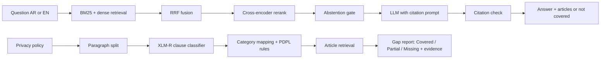

# Sanad - PDPL Compliance Copilot

Hello wonderful reader, yes you, I am talking to you.

Aren’t you READing ME right now? Then you made it to the right place.

Allow me to walk you through the steps needed to explore our recent project, rest assured it will be easy.

And if you think me human then you are certainly mistaken. I am just an AI system, my name is **Sanad**, and I was created by an awesome human group. Now let’s see how this project works, and don’t forget the promise, it is going to be easy.

So what am i? Am an AI-powered assistant for the Saudi Personal Data Protection Law (PDPL): ask me about the law in Arabic or English and you will always see the supporting article, and can check a privacy policy for gaps against a PDPL requirements checklist.

> **Not legal advice.** Outputs are first-pass aids. A requirement marked *Covered* does not mean the organisation is compliant.

**Track:** B (LegalTech, NLP and RAG), Olo Academy AIEP capstone  
**Team:** جودي فيصل العروي · ايه ابراهيم قالو · أنفال عبدالله الردادي

---

## 1. Problem and users

Why we strat with the problem because most startups in the Kingdom have no in-house legal team. A general chatbot can invent article numbers and mix Saudi law with GDPR. This project answers **only from the official texts**, cites the exact article, says *"not covered"* when the texts do not answer, and reviews a privacy policy against the PDPL.

| User | Need |
|---|---|
| Compliance / legal officer | Quick cited answers and a first-pass policy review |
| Product manager / engineer | Practical questions, e.g. "can we store user data outside the Kingdom?" |
| Auditor | The evidence behind every statement |

## 2. What it does

what can i do ? well this 

1. **Structured legal knowledge base**: PDPL, Implementing Regulation and Transfer Regulation (Arabic + English), parsed into article-level chunks with metadata.
2. **Grounded bilingual Q&A**: BM25 + dense retrieval, fusion, cross-encoder reranking, LLM answer with article citations, programmatic citation check, and abstention.
3. **Clause classifier**: XLM-R fine-tuned on OPP-115 (multi-label, per-class thresholds, split by policy).
4. **Gap analyser**: splits a policy into paragraphs, classifies them, applies a PDPL rule layer, and reports **Covered / Partial / Missing** for each of the 15 checklist requirements, with the evidence paragraph and the retrieved article.

## 3. Architecture



---

## 4. Quick start
ohh now we are at the fun part, get ready 

**SOME Requirements:** Python 3.x, internet connection for first-time model downloads, Ollama, and of course enough disk space for local model files and indexes.

### Step 1 — Clone the repository

```bash
git clone https://github.com/judysuper/PDPL-Compliance-Copilot.git
cd PDPL-Compliance-Copilot
```

### Step 2 — Create and activate a virtual environment

Windows PowerShell:

```powershell
python -m venv .venv
.venv\Scripts\Activate.ps1
```

Linux/macOS:

```bash
python3 -m venv .venv
source .venv/bin/activate
```

### Step 3 — Install dependencies

```bash
python -m pip install --upgrade pip
pip install -r requirements.txt
```

### Step 4 — Install and prepare Ollama

The default generation model is:

```text
command-r7b-arabic
```

Install Ollama, then run:

```bash
ollama pull command-r7b-arabic
```

You can verify the model with:

```bash
ollama list
```

### Step 5 — Download the fine-tuned XLM-RoBERTa classifier

The final privacy-policy classifier is hosted on Hugging Face:

```text
ItsJudy/pdpl-opp115-xlm-roberta
```

Download it into the expected local directory:

```bash
hf download ItsJudy/pdpl-opp115-xlm-roberta --local-dir models/xlm_roberta_best
```

### Step 6 — Build the dense FAISS index

```bash
python src/retrieval/dense_retrieval.py
```

This downloads the dense retrieval model automatically if needed and creates:

```text
data/indexes/pdpl_faiss.index
data/indexes/pdpl_metadata.csv
```

The BM25 index is created dynamically at runtime.

### Step 7 — Run the tests

```bash
pytest -q
```

Current integrated test status:

```text
61 passed
```

### Step 8 — Run the demo

```bash
streamlit run app/streamlit_app.py
```

The app contains:

- Ask the Law
- Privacy Policy Gap Analysis

---

## 5. Configuration

The project supports multiple LLM providers.

| Variable | Purpose | Default |
|---|---|---|
| `LLM_PROVIDER` | `gemini`, `ollama` or `mock` | `ollama` |
| `GEMINI_API_KEY` | Gemini API key | none |
| `OLLAMA_MODEL` | Local Ollama model | `command-r7b-arabic` |
| `OLLAMA_URL` | Ollama server | `http://localhost:11434/api/generate` |
| `OLLAMA_NUM_CTX` | Ollama context size | `8192` |

Never commit API keys or secrets.

---

## 6. Models

Large model weights are intentionally not stored directly in GitHub 
let's say i would like to see your device live a little bit longer.

| Component | Model | Source | Setup |
|---|---|---|---|
| Dense Retriever | `intfloat/multilingual-e5-base` | Hugging Face | Auto-download |
| Reranker | `BAAI/bge-reranker-v2-m3` | Hugging Face | Auto-download |
| Generation LLM | `command-r7b-arabic` | Ollama | `ollama pull command-r7b-arabic` |
| Clause Classifier | `ItsJudy/pdpl-opp115-xlm-roberta` | Hugging Face | `hf download ...` or direct loading |

The XLM-RoBERTa classifier can also be loaded directly from Hugging Face:

```python
from src.gap_analyzer.classifier_v2 import XLMRClassifierAdapter

classifier = XLMRClassifierAdapter(
    "ItsJudy/pdpl-opp115-xlm-roberta"
)
```

---

## 7. Data

| Source | What | Use |
|---|---|---|
| PDPL, Implementing Regulation, Transfer Regulation | Official Arabic and English legal text | Knowledge base |
| OPP-115 | 115 privacy policies with paragraph-level annotations | Clause classifier |
| Gold Q&A set | 60 questions, 42 Arabic, 18 English, 10 unanswerable | Retrieval, answers, abstention |
| Local policies | 10 Saudi-operating privacy policies, 150 Gold decisions | Gap analyser evaluation |

OPP-115 is split **by policy**, never by paragraph.

Final split:

```text
Train policies: 79
Validation policies: 18
Test policies: 18
```

---

## 8. Gap analyser

- **Checklist:** 15 PDPL requirements, each with article, source document and verification question.
- **Classifier:** fine-tuned XLM-RoBERTa on OPP-115.
- **Rule layer:** PDPL-specific rules support requirements that are not well represented by OPP-115.
- **Statuses:** `Covered`, `Partial`, `Missing`.

Run:

```bash
python src/gap_analyzer/run_all_policies_v2.py
python src/gap_analyzer/evaluate_all_policies_v2.py
python src/gap_analyzer/gap_analyzer_v3_gold_cv.py
```

---

## 9. Results

### E1 — LLM-only vs naive RAG vs hybrid + rerank

Final reranked retrieval performance:

```text
Recall@5: 0.98
MRR@5:    0.84
```

### E2 — Fixed-size vs article-level chunking

| Strategy | Top-1 | Recall@5 | MRR |
|---|---:|---:|---:|
| Fixed-size | 0.42 | 0.72 | 0.5523 |
| Article-level | 0.40 | **0.78** | **0.5573** |

Article-level chunking was selected because it preserves legal structure and improves Recall@5.

### E3 — Monolingual vs multilingual retrieval

| Query → Document | Recall@5 | MRR |
|---|---:|---:|
| Arabic → Arabic | 0.9118 | 0.6578 |
| Arabic → English | 0.8529 | 0.6475 |
| English → Arabic | 0.8125 | 0.6094 |
| English → English | 0.9375 | 0.7344 |

### E4 — TF-IDF + Logistic Regression vs XLM-RoBERTa

| Metric | TF-IDF + Logistic Regression | XLM-RoBERTa |
|---|---:|---:|
| Macro F1 | 0.7232 | **0.7679** |
| Micro F1 | 0.7508 | **0.7806** |
| Hamming Loss | 0.0845 | **0.0779** |
| Subset Accuracy | 0.4310 | **0.4923** |

Macro-F1 improvement:

```text
+4.47 percentage points
```

Detailed reports:

```text
reports/experiment_E4/
```

### E5 — Abstention

| Configuration | Abstention Accuracy | False Refusal |
|---|---:|---:|
| No instruction / no threshold | 0.00 | 0.00 |
| Instruction only | 0.60 | 0.00 |
| Threshold only | 0.60 | 0.00 |
| Instruction + threshold | **0.80** | **0.00** |

### Gap analyser

| Version | Accuracy | Macro F1 |
|---|---:|---:|
| V2 | 0.6467 | 0.6245 |
| V3 | **0.7000** | **0.6875** |

Gold evaluation:

```text
10 policies
15 requirements
150 decisions
```

---

## 10. Repository layout

```text
app/          Streamlit demo
configs/      configuration files
data/         legal corpus, evaluation data, checklist and local policies
docs/         documentation and figures
notebooks/    experiments and exploration
reports/      experiment results
scripts/      helper and evaluation scripts
src/          retrieval, generation, classifier and gap analyser
tests/        unit and integration tests
```

---

## 11. Model artifacts

Large model artifacts are kept outside GitHub.

### Classifier

Fine-tuned model:

```text
ItsJudy/pdpl-opp115-xlm-roberta
```

Local expected path:

```text
models/xlm_roberta_best/
```

### Dense retrieval

Model:

```text
intfloat/multilingual-e5-base
```

Generated index:

```text
data/indexes/pdpl_faiss.index
data/indexes/pdpl_metadata.csv
```

### Reranker

Model:

```text
BAAI/bge-reranker-v2-m3
```

### Generation

Model:

```text
command-r7b-arabic
```

The repository excludes large files and caches such as:

```text
models/
*.safetensors
*.bin
*.pt
*.pth
hf_cache/
```

---

## 12. Responsible AI and limitations

Well because i am a Responsible AI that works with the laws am also not perfect and have a little bit of what human called a down side aka a limitations

here are some things you need to know 

- **Not legal advice.** The app is a support tool, not a substitute for qualified legal review.
- **Covered does not prove operational compliance.**
- **Grounding:** answers are generated from retrieved legal evidence.
- **Citation checking:** cited articles are checked against retrieved context.
- **Abstention:** weak retrieval can trigger a not-covered response.
- **OPP-115 limitation:** its categories are not equivalent to Saudi PDPL legal requirements.
- **Gap Analyzer limitation:** rule-based decisions can over-credit a requirement when keywords appear without the full operational practice.
- **Local policy sample:** the 10 annotated privacy policies form an initial evaluation set, not a comprehensive regulatory benchmark.
- **Legal updates:** amended PDPL texts require the legal corpus and retrieval indexes to be updated.

---

## 13. Acknowledgements

This project was developed as the **Track B capstone project** for the **Olo Academy AI Engineering Program (AIEP)** by one of the most great groups ever miss Judy and Ayah and Anfal 

Acknowledgements:

- SDAIA and official Saudi legal sources
- OPP-115 / Usable Privacy Policy Project
- Hugging Face
- Transformers
- Sentence Transformers
- FAISS
- Ollama
- Streamlit
- and of course Our elite Instructors
for their **I**nvaluable **H**elp and **M**entorship ⭐️.

---

Finally it was pleasure to mmet you, See I told you it would be easy, and I hope you like the project.

— **Sanad**